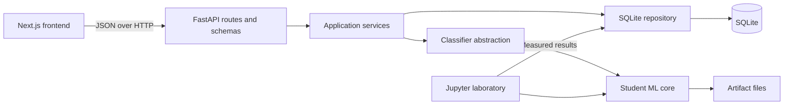

# Architecture

This is a modular monolith in a monorepo. Run the Next.js UI and FastAPI backend as two local processes; the backend imports the ML core directly. SQLite and artifact files stay on the same machine.

## Frontend

`frontend/` contains Next.js App Router pages, TypeScript API contracts, reusable components, Tailwind setup, and responsive styles. Requests originate in the browser through `src/lib/api.ts`; `NEXT_PUBLIC_API_URL` is baked into the frontend build. UI state distinguishes unavailable data, empty collections, errors, and completed responses. The six planned experiments are static curriculum information, not claimed training results.

## Backend

`backend/app/main.py` is the composition root. `create_app()` accepts alternate database paths, registries, and artifact directories for tests. Pydantic rejects malformed inputs. API routers delegate to the repository and intelligence service. A dedicated exception handler renders unfinished ML as an HTTP 501 structured development error. Unexpected failures return HTTP 500 and are logged locally.

The model registry constructs classifiers through factories. Routes and prediction/training services depend on the abstract contract, not on Naive Bayes details. Student code errors cannot be converted to plausible prediction data. Result validation checks categories, probability dimensions, finite values, bounds, and row totals before writing a prediction.

## Database

`backend/app/database/` uses Python's standard SQLite driver, parameterized SQL, per-operation connections, transactions, foreign keys, and WAL mode. Startup creates missing tables idempotently. `DATABASE_PATH` resolves relative to the project root unless absolute.

| Table | Responsibility |
| --- | --- |
| `tickets` | Raw text, optional actual and predicted categories, confidence, model version, UTC creation time |
| `model_versions` | Unique version, classifier key, artifact path, creation time |
| `evaluation_results` | Student-computed scores, dataset name, model foreign key, creation time |
| `training_runs` | Selected classifier, running/blocked/failed/completed state, error, timestamps |

The repository supports ticket creation, reads, labeling, deletion, prediction updates, model registration, evaluation storage, training history, and dashboard aggregates. There are no automatic seed records. Schema creation is intentionally simple; a future schema change needs an explicit migration.

## ML laboratory

`ml/data/raw/` and `ml/data/processed/` are empty, ignored data locations. `ml/notebooks/` contains six valid Jupyter experiments with objectives, problem statements, and empty sections. NumPy, pandas, matplotlib, JupyterLab, and scikit-learn are available for student work. Application code does not import scikit-learn. `ml/tests/` contains student-owned test locations.

## ML core

`ml/src/` contains the `Classifier` abstraction and student stubs for preprocessing, tokenization, representations, classifiers, and evaluation. Every unfinished behavior has a student marker and raises `StudentMLNotImplemented`. Type annotations specify integration boundaries; no algorithm, pseudocode solution, alternative implementation, or remote prediction fallback is supplied.

## Model artifacts

`ml/artifacts/` holds files or directories written by the student's `save()` implementation. The database contains only paths and metadata. A successfully saved model is registered and activated. Startup restores the latest registered model using its classifier factory and `load()`. The artifact must exist at the supplied path. Artifacts are local and trusted; do not import unknown serialized models. Serialization behavior remains the student's responsibility.

## Information flow

1. Creating a ticket validates and stores its text and optional actual label without invoking ML.
2. Classification reads the saved ticket and invokes `predict` and `predict_proba` on the active classifier. An unfinished method returns a clean development error and leaves prediction fields empty. Valid results update the ticket's latest prediction metadata. V1 does not maintain a separate prediction-event history; dashboard predictions are ordered by ticket ID.
3. Training creates a run, reads labeled tickets, calls the selected classifier's `fit`, and then `save`. A missing implementation marks the run blocked. Other errors mark it failed. A successful artifact is registered, the run is completed, and the model becomes active.
4. Students evaluate models in the laboratory and store measured metrics through the repository. No evaluation algorithm runs implicitly in the backend.
5. The dashboard queries stored values. The latest evaluation is the most recently inserted result, which may belong to a different version from the active model; the Models page associates results by model ID.

V1 assumes a single local backend process. Training is synchronous, and experiments that need splits or long-running work should remain in notebooks. The complete labeled dataset is passed to `fit`; the infrastructure does not split, tokenize, or transform it. Any startup artifact restoration failure is visible to the operator.
